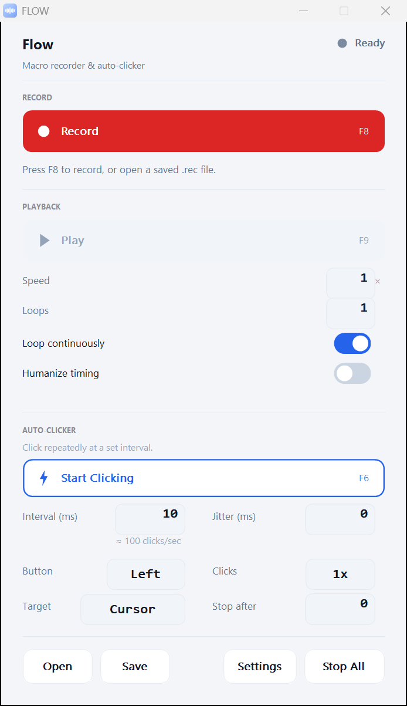

# FLOW

FLOW (Flexible Low-latency Operations Workflow) is a macro recorder and auto-clicker for Windows.

[](https://github.com/dominikkoenitzer/Flow/actions/workflows/ci.yml)

<p align="center">
  
</p>

## Download

[Download FLOW](https://flow.punds.ch), then double-click it. There is nothing to install.

Windows may say "Windows protected your PC"; click More info, then Run anyway.

FLOW then asks for Administrator rights; click Yes. Windows does not let a normal process replay input into a window that runs as Administrator (Task Manager, an elevated terminal, most installers) or record input while one has focus. Elevated, FLOW works in every window.

It runs on Windows 10 and 11 (64-bit). The exe is statically linked, so it needs no runtime.

### Other downloads

The [release page](https://github.com/dominikkoenitzer/Flow/releases/latest) also has `FLOW-win64.zip` (the same exe plus the license) and `SHA256SUMS.txt` (checksums for both). To check a download, compare its hash with the value in `SHA256SUMS.txt`:

```powershell
Get-FileHash .\FLOW.exe -Algorithm SHA256
```

Some antivirus engines flag automation tools that use global input hooks. This is a false positive that comes with this kind of software.

## What it does

| Part | What it does |
|---|---|
| Record | Captures mouse moves, clicks (left, right, middle and the two side buttons), vertical and horizontal wheel scrolling, and keystrokes, with microsecond timestamps. FLOW's own hotkeys stay out of the recording. |
| Playback | Replays the macro at a speed from 0.1x to 100x, for 1 to 999 loops or continuously. Humanize timing adds Gaussian jitter to every delay of a millisecond or more. Mouse moves replay as absolute coordinates on the whole virtual desktop, so they land on the right monitor. |
| Auto-clicker | Clicks every 1 to 10,000 ms with the left, right or middle button, as a single, double or triple click. It clicks at the cursor or at a fixed point you pick by dragging from the Target field. Jitter varies each interval at random; Stop after ends it after a set count, and 0 runs it until you stop it. |

- Save a macro as a `.rec` file. Open it again with Open, or drop it onto the window.
- The Settings button holds Customize Hotkeys, Trim & Timing, Create Play Shortcut, Always on Top, Reopen Last Macro on Launch, Clear Recording and About.
- Trim & Timing cuts the recording to a span (start and end in milliseconds) and can shorten every pause over a set length, the wait before the first event too. It shows how many events and seconds it keeps before you apply. A key or button held across the cut start is pressed again at the start, and one the cut end leaves held is released at the end.
- `FLOW.exe --play "macro.rec"` opens that macro, plays it once with the current speed and loop settings, and closes when the run ends. If FLOW is already open, the open window plays it instead. Create Play Shortcut puts such a shortcut on the desktop for the last opened or saved macro. FLOW runs as administrator, so a shortcut shows the UAC prompt each time.
- FLOW reopens where you left it.
- Timing runs on the performance counter. Each wait sleeps until the last few milliseconds and spins the rest, and playback keeps to one schedule from the start of the run, so delays stay accurate below a millisecond and do not add up over a long macro.
- The window is native Win32 drawn with GDI+, and it follows each monitor's DPI scale.

### Hotkeys

The hotkeys work system-wide, also while another window has focus.

| Action | Default key |
|---|---|
| Start/stop recording | `F8` |
| Start/stop playback | `F9` |
| Toggle auto-clicker | `F6` |
| Stop everything | `Pause` |

To change them, open Settings → Customize Hotkeys, click a field and press a key: F1 to F12, A to Z or 0 to 9.

## Your data, updates and removal

FLOW keeps its settings in one plain-text file, `%APPDATA%\FLOW\settings.cfg`: hotkeys, speed, loops, the clicker options, the switches, the path of the last opened or saved macro, and the window position. It reads the file when it starts, writes it as soon as you change a setting, and saves the window position when it closes.

Macros (`.rec` files) are saved only where you choose in the Save dialog. FLOW keeps no copy of them and has no recordings folder of its own. It writes no log files and nothing to the registry.

### Updating

Close FLOW, then download the new [FLOW.exe](https://flow.punds.ch) over the old one. Your settings stay, since they live in `%APPDATA%\FLOW` and not next to the exe.

### Removing FLOW

1. Close FLOW.
2. Delete `FLOW.exe`.
3. Delete the folder `%APPDATA%\FLOW`. Typing `%APPDATA%` into the Explorer address bar takes you there.
4. Delete any `.rec` files you saved, if you no longer want them.

There is nothing else to uninstall.

## Build from source

The toolchain is MinGW-w64 g++ (C++17) from MSYS2 UCRT64, the same one CI uses. The repo pins no compiler version; CI installs the current MSYS2 packages. These steps set it up on a fresh Windows PC. Run them in PowerShell, except the `pacman` line.

1. Install Git and MSYS2 (MSYS2 goes to `C:\msys64`):

   ```powershell
   winget install --id Git.Git --exact
   winget install --id MSYS2.MSYS2 --exact
   ```

2. Open MSYS2 UCRT64 from the Start menu (or run `C:\msys64\ucrt64.exe`) and install g++ and `windres`:

   ```sh
   pacman -Syu --needed mingw-w64-ucrt-x86_64-gcc mingw-w64-ucrt-x86_64-binutils
   ```

   If pacman asks you to close the window, close it, open MSYS2 UCRT64 again and run the same line again.

3. Back in PowerShell, add `C:\msys64\ucrt64\bin` (where `g++` and `windres` live) to your user `PATH`:

   ```powershell
   [Environment]::SetEnvironmentVariable('Path', [Environment]::GetEnvironmentVariable('Path', 'User') + ';C:\msys64\ucrt64\bin', 'User')
   ```

4. Open a new PowerShell window. A terminal that was open during the installs does not see Git or the new `PATH`. Then check the toolchain, clone and build:

   ```powershell
   g++ --version
   git clone https://github.com/dominikkoenitzer/Flow.git
   cd Flow
   powershell -NoProfile -ExecutionPolicy Bypass -File .\scripts\build.ps1
   ```

The exe lands in `build\Release\FLOW.exe`. Add `Debug` to the last line for a debug build in `build\Debug\FLOW.exe`. `-ExecutionPolicy Bypass` lets this one script run on a PC where scripts are off by default, without changing that setting. If your PC already runs local scripts, `.\scripts\build.ps1` is enough. The script stops with an error if `windres` fails, since the exe needs the embedded manifest to ask for Administrator rights.

`.\scripts\test.ps1` builds and runs the engine tests. They need no window and no Administrator rights.

The raw invocation, in PowerShell from the `Flow` folder, is the build CI runs:

```powershell
New-Item -ItemType Directory -Force build | Out-Null
windres resource.rc -O coff -o build/resource.o
$src = (Get-ChildItem src -Recurse -Filter *.cpp).FullName
g++ -std=c++17 -O3 -DNDEBUG -Wall -Wextra -Werror -mwindows -I include -o build/FLOW.exe $src build/resource.o -luser32 -lgdi32 -lcomctl32 -lgdiplus -lshell32 -lole32 -luuid -static -static-libgcc -static-libstdc++
```

The `-static` flag is required: it puts the MinGW runtime (`libwinpthread`, `libstdc++`, `libgcc`) inside the exe, so it runs on machines without MinGW.

See [CONTRIBUTING.md](CONTRIBUTING.md) for the development setup, coding conventions and how to test changes.

## Project structure

| Path | What it is |
|---|---|
| `src/main.cpp` | The window procedure, control creation and `WinMain`: the Win32 shell. |
| `src/AppState.cpp` / `include/AppState.h` | Control IDs, cached fonts, and the single `AppState` the whole GUI reads. |
| `src/Settings.cpp` / `include/Settings.h` | `%APPDATA%\FLOW\settings.cfg` load/save. |
| `src/Hotkeys.cpp` / `include/Hotkeys.h` | The four global hotkeys and key-name formatting. |
| `include/ui/Theme.h` | The design system: palette, layout grid, DPI scaling. One source for both painting and control placement. |
| `src/ui/Dpi.cpp` / `include/ui/Dpi.h` | Per-monitor DPI lookups and frame sizes, so each window follows its monitor's scale. |
| `include/ui/Placement.h` | Keeps a restored window inside its monitor's work area. |
| `src/ui/Draw.cpp` / `include/ui/Draw.h` | Anti-aliased GDI+ primitives and the vector glyphs. |
| `src/ui/Buttons.cpp` / `include/ui/Buttons.h` | The owner-draw buttons, toggles and key fields. |
| `src/ui/Dialogs.cpp` / `include/ui/Dialogs.h` | The hotkey-customization and About dialogs. |
| `src/FlowEngine.cpp` / `include/FlowEngine.h` | UI-agnostic engine (`flow` namespace): recording, playback, auto-clicker, timing, humanization. |
| `resource.rc` / `FLOW.manifest` | App icon and manifest (admin elevation, visual styles, DPI awareness), embedded via `windres`. |
| `tests/` | doctest suite over the engine: humanization, the .rec format, timing, the clicker, window placement. |
| `scripts/build.ps1` | Build script (Release/Debug) wrapping the g++ invocation. |
| `scripts/test.ps1` | Builds and runs the test suite. |
| `scripts/package.ps1` | Produces the release artifacts (zip, exe, SHA-256) locally. |
| `.github/workflows/ci.yml` | Build, tests and the self-contained/manifest check on every push and PR to `main`. |
| `.github/workflows/release.yml` | Builds and publishes the rolling `flow` GitHub Release when the tag is pushed. |

## Cutting a release

There is a single unversioned release, `flow`, which always holds the latest build. There are no version numbers.

[`.github/workflows/release.yml`](.github/workflows/release.yml) does the release. To publish, force-move the `flow` tag onto the latest commit and push it:

```powershell
git tag -f flow
git push -f origin flow
```

The workflow builds its own binary, checks that it is self-contained and carries the manifest, and only then updates the GitHub Release titled FLOW with the exe, the zip and the checksums. It does not wait for CI.

To build the release artifacts locally without GitHub, run [`scripts/package.ps1`](scripts/package.ps1).

## Contributing and security

Read [CONTRIBUTING.md](CONTRIBUTING.md) for the setup and conventions, and open an issue before large changes. Report security issues as [SECURITY.md](SECURITY.md) describes.

## License

All rights reserved. No license is granted for reuse, modification, or redistribution of this code. You may view the source here, but it is not open-source software. If you'd like to use part of FLOW, please open an issue to ask. See [LICENSE](LICENSE).

## Disclaimer

FLOW is intended for legitimate automation of repetitive tasks. You are responsible for complying with the terms of service of any software you use it with.

## Author

Built and written by [@dominikkoenitzer](https://github.com/dominikkoenitzer).
